  

# 🍏 Awesome macOS Software Curations & Developer Resources

  
  
  
  
  
  
  

> 🚀 **A curated directory and ecosystem overview of top macOS software curations, package managers, app stores, developer utilities, and discovery catalogs.**

Discover, install, automate, and configure macOS applications and developer environments using vetted SaaS platforms and top-rated open-source command-line tools. 💻✨

---

## 📑 Table of Contents
- [📊 Sector Overview & Market Dynamics](#-sector-overview--market-dynamics)
- [☁️ SaaS & Hosted Discovery Platforms](#️-saas--hosted-discovery-platforms)
- [🛠️ Open-Source Package Managers & Curated Repositories](#️-open-source-package-managers--curated-repositories)
- [🧩 Recommended Stack & Setup Automation](#-recommended-stack--setup-automation)
- [🤝 How to Contribute](#-how-to-contribute)
- [🌟 Star History](#-star-history)
- [💖 Support & Community](#-support--community)
- [⚖️ Disclaimer](#️-disclaimer)

---

## 📊 Sector Overview & Market Dynamics

The global desktop operating system application and digital distribution ecosystem is estimated at **$24 billion to $26 billion** in platform software spend, with the broader App Store economy driving over **$1.4 trillion** in global digital and physical commerce. 🌐📈

The market displays a **highly concentrated, "winner-take-all" dynamic** at the core distribution and operating system layer dominated by Apple (via the Mac App Store and platform gatekeeping), complemented by an indispensable, community-standard open-source package management layer (led by Homebrew), while indie subscription bundles (such as Setapp) and catalog directories operate in a moderately fragmented secondary discovery tier. 🎯🔍

---

## ☁️ SaaS & Hosted Discovery Platforms

The table below outlines leading commercial app bundles, hosted directories, and ecosystem distributors, ranked in descending order of organization size (market capitalization, valuation, or estimated annual revenue). 💼🏢

| Platform | 📈 Valuation / Company Scale | 💳 Starting Pricing | 🎁 Free Tier / Free Trial Limits | 📝 Description & Ecosystem Role |
| :--- | :--- | :--- | :--- | :--- |
| **[Mac App Store](https://www.apple.com/app-store/)** | **~$3.0+ Trillion Market Cap** (Apple Inc., NASDAQ: AAPL; $117B+ annual consumer app spend) | Free to browse; developer distribution starts at **$99/year** (Apple Developer Program); apps priced individually | **Free for life** for browsing, downloading free/freemium macOS apps, and system updates | 🍏 Apple's official distribution channel for sandboxed, notarized macOS applications with automated updates and Family Sharing. |
| **[CNET Download (Mac)](https://download.cnet.com/mac/)** | **~$1.4+ Billion Annual Revenue** (Parent company Ziff Davis, NASDAQ: ZD; acquired CNET for ~$100M) | Free to access; monetized via software partnerships & ads | **Free for life** unlimited browsing, direct software downloads, and reviews | 📰 Longstanding software discovery directory offering curated editorial reviews, safe downloads, and version tracking for Mac utilities. |
| **[MacPaw](https://macpaw.com/)** | **~$90 Million Annual Revenue** (Bootstrapped / estimated private valuation $350M–$500M) | CleanMyMac starts at **$39.95/year** for 1 Mac; standalone licenses available | **Free edition with scan limits** (e.g., cleans up to 500 MB of system junk free of charge) | 🧹 Major macOS independent software vendor and creator of CleanMyMac, Moonlock, and the Setapp subscription marketplace. |
| **[Setapp](https://setapp.com/)** | **Part of MacPaw** (~$90M company ARR; Setapp estimated $25M–$35M ARR) | **$9.99/month** (billed annually at $8.99/month) for 1 Mac | **7-day free trial** with full unrestricted access to 240+ curated macOS apps | 📦 Curated subscription bundle for macOS and iOS providing unlimited access to 240+ premium productivity and developer applications. |
| **[Softpedia Mac](https://mac.softpedia.com/)** | **~$15 Million – $25 Million Annual Revenue** (SoftNews NET SRL; privately held) | Free to access; premium ad-free and sponsor placements available | **Free for life** unlimited access to index, software change-logs, and verified downloads | 🔍 Comprehensive software archive tracking version histories, malware scans, and direct installer downloads across thousands of Mac utilities. |
| **[MacUpdate](https://www.macupdate.com/)** | **~$3 Million – $6 Million Annual Revenue** (Clario Tech / independent private) | MacUpdate Desktop subscription starts at **$9.99/year** (regularly $19.99/year) | **Free trial limited to 4 app updates or uninstalls**; website browsing is free for life | 🔄 Longstanding Mac software directory and desktop client providing centralized app updating, curated reviews, and discount promotions. |
| **[MacSurfer](https://www.macsurfer.com/)** | **<$1 Million Annual Revenue** (Independent niche web property) | **$0 (100% Free)** | **Free for life** unrestricted access to curated daily Apple & macOS headlines | 🗞️ Veteran news aggregator indexing headline updates, software releases, security patches, and community news across the Mac landscape. |

---

## 🛠️ Open-Source Package Managers & Curated Repositories

Community-driven, open-source repositories and package management utilities, sorted in descending order by GitHub stargazers count. 🌟💻

| Project | ⭐ Stars | 🎯 Focus & Description |
| :--- | :--- | :--- |
| **[Awesome-Awesome-Awesome](https://github.com/ishandutta2007/Awesome-Awesome-Awesome)** |  | 👑 The root index of curated awesome-lists, containing foundational references for macOS developers, shells, and software ecosystems. |
| **[jaywcjlove/awesome-mac](https://github.com/jaywcjlove/awesome-mac)** |  | 🏆 The premier macOS software curation guide on GitHub, organizing high-quality apps, CLI utilities, and developer tools by category. |
| **[serhii-londar/open-source-mac-os-apps](https://github.com/serhii-londar/open-source-mac-os-apps)** |  | 📚 Massive catalog of awesome open-source macOS software with primary links, licenses, Swift/Objective-C tech stacks, and star counts. |
| **[Homebrew/brew](https://github.com/Homebrew/brew)** |  | 🍺 The missing package manager for macOS; provides command-line formulas and GUI casks used as the de facto standard by Mac developers. |
| **[iina/iina](https://github.com/iina/iina)** |  | 🎬 Modern media player for macOS built with Swift, mpv, and native macOS design patterns (Picture-in-Picture, Touch Bar, dark mode). |
| **[MonitorControl/MonitorControl](https://github.com/MonitorControl/MonitorControl)** |  | 🖥️ Essential utility to control external monitor brightness, volume, and contrast natively via keyboard keys and DDC/CI commands. |
| **[mathiasbynens/dotfiles](https://github.com/mathiasbynens/dotfiles)** |  | ⚙️ Benchmark sensible macOS default configurations, terminal settings, and developer environment bootstrapping scripts. |
| **[asmvik/yabai](https://github.com/asmvik/yabai)** |  | 🪟 Tiling window management utility for macOS based on binary space partitioning, enabling complete keyboard-driven window workflows. |
| **[nikitabobko/AeroSpace](https://github.com/nikitabobko/AeroSpace)** |  | 🚀 An i3-like tiling window manager for macOS that does away with macOS Spaces limitations for high-performance developer ergonomics. |
| **[sindresorhus/quick-look-plugins](https://github.com/sindresorhus/quick-look-plugins)** |  | 👁️ Curated list of useful macOS Quick Look plugins for developers (syntax highlighting, JSON, markdown, webp, and zip archive previewing). |
| **[FelixKratz/SketchyBar](https://github.com/FelixKratz/SketchyBar)** |  | 📊 Highly customizable macOS status bar replacement providing complete aesthetic and functional control for developer desktops. |
| **[mas-cli/mas](https://github.com/mas-cli/mas)** |  | 💻 Simple command-line interface for the Mac App Store, designed for unattended scripting, dotfiles automation, and setup scripts. |
| **[rgcr/m-cli](https://github.com/rgcr/m-cli)** |  | 🔧 Swiss Army knife for macOS system administration, offering CLI toggles for Bluetooth, Wi-Fi, audio, firewall, dock, and power management. |
| **[guarinogabriel/Mac-CLI](https://github.com/guarinogabriel/Mac-CLI)** |  | ⚡ Automated macOS command-line suite for developers and power users, speeding up maintenance, cleanup, and dev tool setup. |
| **[glushchenko/fsnotes](https://github.com/glushchenko/fsnotes)** |  | 📝 Modern, open-source file-system-based Markdown note manager for macOS and iOS with Git integration and native performance. |
| **[linearmouse/linearmouse](https://github.com/linearmouse/linearmouse)** |  | 🖱️ Utility that enables independent mouse and trackpad scroll direction, acceleration curves, and button mapping on macOS. |
| **[milanvarady/Applite](https://github.com/milanvarady/Applite)** |  | 🛍️ Beautiful, user-friendly native GUI app store for macOS powered entirely by Homebrew Cask. |
| **[sbmpost/AutoRaise](https://github.com/sbmpost/AutoRaise)** |  | 🖱️ Auto-raise focus-follows-mouse utility for macOS, popular among developers and multi-monitor power users. |
| **[justrach/nanobrew](https://github.com/justrach/nanobrew)** |  | ⚡ Lightweight, security-conscious Homebrew client implementing a tiered verification engine and isolated bottle mirrors. |
| **[macports/macports-base](https://github.com/macports/macports-base)** |  | ⚓ The legacy ports-based UNIX software package management system for macOS, compiling tools directly from verified sources. |
| **[abordage/awesome-mac](https://github.com/abordage/awesome-mac)** |  | 📑 Community-driven collection of software, utilities, and developer resources for macOS, featuring automated badge updates. |
| **[onmyway133/awesome-open-source-mac-apps](https://github.com/onmyway133/awesome-open-source-mac-apps)** |  | 📋 Hand-curated index of open-source macOS software categorized by developer utilities, media players, and system extensions. |

---

## 🧩 Recommended Stack & Setup Automation

When configuring a reproducible Mac development machine, combine these complementary layers: 🛠️✨
1. **Package Management**: Install **[Homebrew](https://github.com/Homebrew/brew)** for CLI formulas and GUI applications (`brew install --cask`). 🍺
2. **App Store CLI Automation**: Use **[mas-cli](https://github.com/mas-cli/mas)** to script App Store installations directly in your provisioning dotfiles. 💻
3. **Visual Exploration**: Run **[Applite](https://github.com/milanvarady/Applite)** for a clean, graphical store interface over your Homebrew casks. 🛍️
4. **Window Management & Ergonomics**: Leverage **[AeroSpace](https://github.com/nikitabobko/AeroSpace)** or **[yabai](https://github.com/asmvik/yabai)** alongside **[MonitorControl](https://github.com/MonitorControl/MonitorControl)** and **[LinearMouse](https://github.com/linearmouse/linearmouse)** for high-efficiency workflows. 🪟
5. **Software Discovery**: Reference **[jaywcjlove/awesome-mac](https://github.com/jaywcjlove/awesome-mac)** and **[serhii-londar/open-source-mac-os-apps](https://github.com/serhii-londar/open-source-mac-os-apps)** when scouting replacements for proprietary utilities. 🔍

---

## 🤝 How to Contribute

Contributions are always welcome! 💖
1. Fork this repository. 🍴
2. Create a new branch: `git checkout -b feature/new-macos-resource`. 🌿
3. Add or update items in `README.md` following the tabular layout. For open-source repos, include the social star badge linking to the `/stargazers` URL. ⭐
4. Ensure entries are factual, active, and relevant to macOS software curation or developer workflows. ✅
5. Submit a Pull Request with a clear description of the project. 🚀

---

## 🌟 Star History

---

## 💖 Support & Community

Thank you so much for exploring and using this curated resource! If you find this repository valuable, here are a few great ways you can support the project:

- ⭐ **Star this repository** to help others discover it across GitHub.
- 🍴 **Fork and share** it with fellow macOS developers, teams, and communities.
- ☕ **Buy me a coffee / Sponsor**: If this project helped your daily Mac setup, consider supporting ongoing curation and development via the [GitHub Sponsors Dashboard](https://github.com/sponsors/ishandutta2007).

Your support keeps this ecosystem up to date, comprehensive, and freely accessible to everyone in the macOS open-source community! 🙌🎉

---

## ⚖️ Disclaimer

- This is a community-curated directory intended for educational and developer productivity purposes; inclusion does not constitute a commercial endorsement. 🛡️
- Package managers and repositories execute build scripts and third-party binaries; always review formulae, casks, and release signatures before installing on production systems. 🔐
- Commercial trademarks and service marks belong to their respective owners. 🏷️
